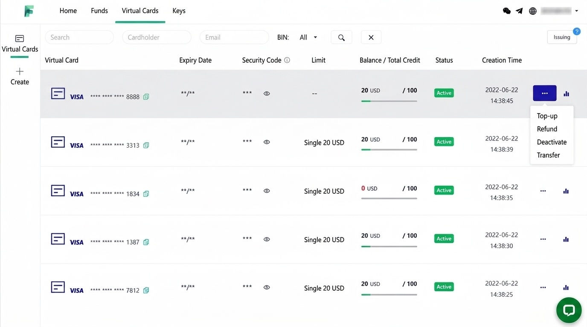
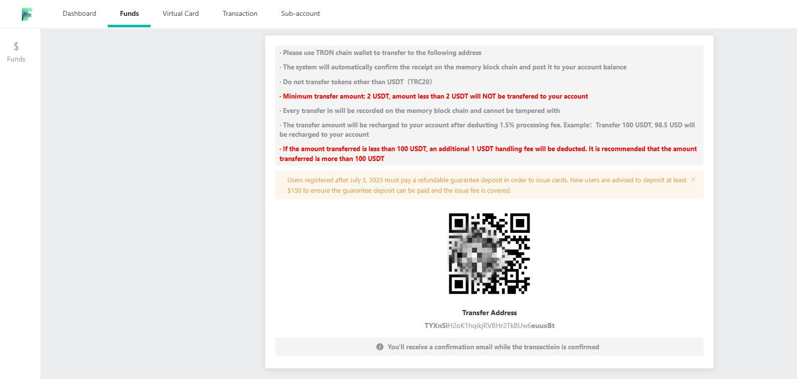
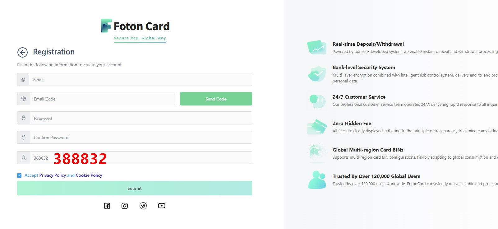
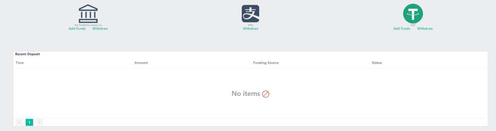
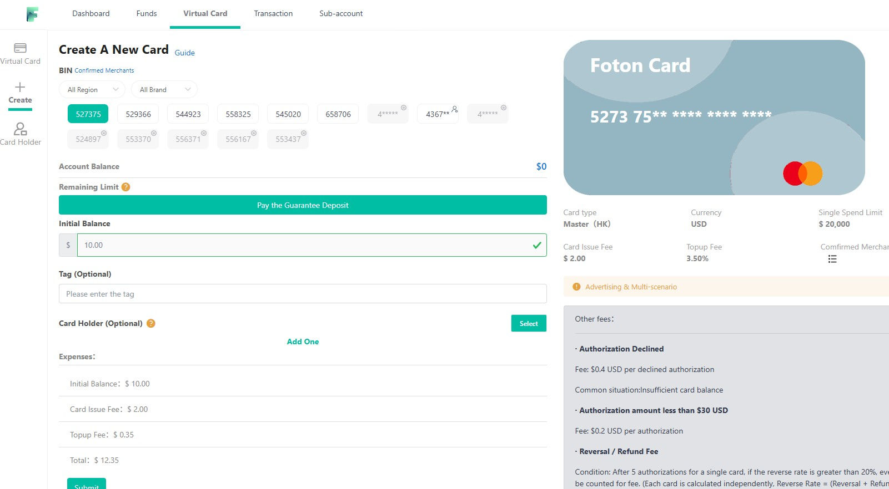
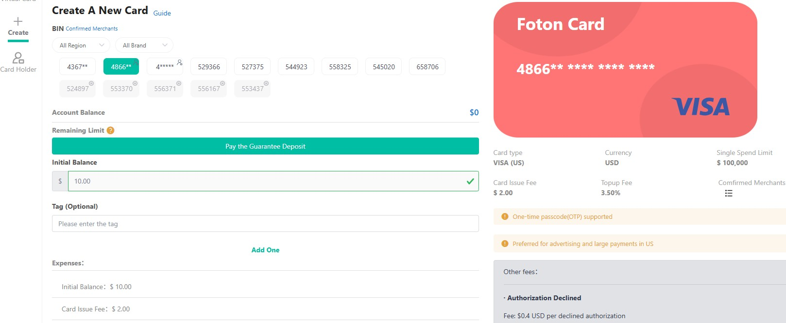

BEST CRYPTO VIRTUAL CARD NO KYC · Global Payment & Collection

# Best Crypto Virtual Card No KYC — Powered by FotonCard

Secure payment solutions for ad spending and AI subscriptions. An enterprise-grade virtual credit card service from a professional card issuer, with real-time USDT top-ups — covering Facebook / TikTok / Google ad campaigns, ChatGPT Ads, ChatGPT / Claude and other AI tool subscriptions, cross-border e-commerce purchasing, and more. The FotonCard mobile app is live, so you can manage your virtual cards anytime, anywhere.

**[Get Started Now](https://dashboard.fotoncard.com/#/pages/register?agent=388832)**

- USDT Top-up / No Monthly Fee / 3DS Verification / Multiple BINs / Bulk Card Issuing / ChatGPT Plus / Ad Billing / Overseas Shopping

## Table of Contents

## Best Crypto Virtual Card No KYC: About the FotonCard Platform

### A Established Virtual Credit Card Issuer, Running Stably for 6 Years

FotonCard is a veteran virtual credit card issuing platform that has been operating stably for six years. As a professional overseas card vendor and virtual card issuer, it offers a very rich selection of card types: multiple different BINs (card prefixes) to choose from, so you can match different cards to different purposes — and it is also well suited to issuing cards in large batches. In short, if you have been comparing options on Reddit and review forums for the best crypto virtual card with no KYC, this six-year track record is exactly the kind of longevity those discussions prize.

You can use it to pay for legitimate purposes such as ChatGPT Plus, ad fees, and overseas online shopping. It supports USDT top-ups with no monthly fee. Some BINs support 3DS verification, and the compatibility is worth praising.

100+ Countries & Regions Covered
50,000+ Partner Merchants
99.9% System Availability

**FotonCard** sample card visual (pure HTML + CSS): Card number `4312 7856 0019 2847` · Card Holder: FOTON CARD MEMBER · Valid Thru: 12/28

---

## Platform Advantages

The platform deliberately maintains a certain entry threshold and reasonable user-policy restrictions, which effectively prevents abuse and improves stability.

- **Entry Threshold** No business certification required — individual users can register directly, and USDT top-ups are KYC-free for greater convenience.
- **Stable & Reliable** Unlike low-barrier platforms that tend to collapse or run off with funds, FotonCard ensures continuous, stable service through sensible user policies.
- **Rich BIN Selection** Multiple card BINs to choose from, with bulk card issuing supported — ideal for users who issue cards at scale. As a professional issuer, FotonCard carries dozens of card BINs issued in Hong Kong, the United States, Singapore, and more.

### Why Choose FotonCard

Simple design and dependable technology, safeguarding your cross-border business.

- Global coverage — supports multiple currencies and local payment methods, easily receiving payments from customers worldwide.

- Security & compliance — enterprise-grade safeguards, including PCI DSS certification, data encryption, and risk-control systems.

- Fast settlement — automated settlement with real-time transaction tracking and rapid fund arrival.

- Data analytics — comprehensive analytics and reporting so you can monitor every market in real time.

- Multi-currency support — 100+ currencies with live exchange rates, low fees, and transparent transactions.

- Sub-account management — a powerful "sub-account" system plus a professional card issuing center, convenient for ad marketers managing campaigns in groups.

FotonCard management dashboard — one place to manage your virtual cards, top-ups, and transaction records.

[Play the platform introduction video (foton-video.mp4)](foton-video.mp4)

**[Register Now — Invite Code 388832](https://dashboard.fotoncard.com/#/pages/register?agent=388832)**

---

## Key Information & Fee Schedule

Clear and transparent pricing, so you can spend with confidence.

### FotonCard Fee Description

The table below lists the platform's base rates; enterprise users enjoy even better pricing.

| Item | Details |
| --- | --- |
| Top-up methods | USDT, USD bank transfer |
| Minimum top-up | 20 USDT |
| Top-up fee | 1–3% (depends on user tier) |
| Monthly fee | None. Card issuing fee is USD 2–3 per card; discounts negotiable for large volumes |
| KYC verification | No KYC required — USDT top-ups need no verification |
| Important notes | Note: to keep card BINs running stably long-term and filter out freebie-abuse users, the platform has a security deposit system: you must pay a USD 100 deposit before issuing your first card; the deposit is refundable once your chargeback and refund rates meet the required standard. |

**[Issue Your First Card — USDT Top-up, No KYC](https://dashboard.fotoncard.com/#/pages/register?agent=388832)**

---

## Use Cases

As a professional VCC issuing platform, FotonCard covers mainstream international online payment needs — one card, many uses.

AI Subscriptions** ChatGPT, Claude, Midjourney, and more
Ad Spending** Facebook, Google, TikTok ad fees
Cross-border E-commerce** Amazon, eBay, AliExpress, Shopify
Streaming** Netflix, YouTube Premium, Spotify
Travel & Flights** International flights, hotels, OTA platforms
Cloud Services** Google Cloud, AWS, Azure
App Stores** Google Play, Apple App Store
Overseas Shopping** International e-commerce and proxy purchasing

---

## Advertising Solutions

As a professional overseas card vendor, FotonCard is deeply optimized for Facebook / TikTok / Google ad scenarios and supports ChatGPT Ads placements.

### Facebook / Meta Ads

Why do advertisers need virtual cards? Facebook ad spend is heavy and billing is frequent; physical bank cards easily trigger risk-control freezes. FotonCard virtual cards support running many cards in parallel — one account can issue multiple cards, each bound to a different ad account, effectively isolating risk.

- BIN selection: the 456599 BIN is recommended — it supports 3DS verification codes and has a high card-linking success rate.

- Multi-card strategy: issue separate cards for different ad accounts (main and backup) to avoid concentrating risk on a single card.

- Bulk issuing: enterprise users can issue cards in bulk to meet the scale needs of ad teams.

- Cost advantage: enterprise rates as low as 1%; better pricing available for heavy spend.

### TikTok Ads — TikTok for Business

TikTok ads are similar to Facebook; US/UK virtual cards are supported. It is advisable to issue a separate card for each ad account for easy reconciliation and risk isolation.

- Recommended BINs: mainstream BINs such as 456599 and 556150 all work normally.

- Billing address: use an address consistent with the ad account's registration information.

- Cautions: some obscure BINs may be rejected by TikTok — prefer BINs that have been tested.

### Google Ads & the Developer Ecosystem

Google Ads has a fixed billing cycle, and virtual cards fit the monthly billing model perfectly. Google Cloud, Google Play developer accounts, and similar scenarios are also supported.

- Stable billing: Google auto-charges on the billing date — just keep the card balance sufficient.

- One card, many uses: the same card can be linked to both Google Ads and Google Cloud.

- Developer scenarios: supports the one-time USD 25 Google Play developer registration fee.

> **Ad Spending Tips** For your first card, top up a small amount to test; add more balance only after card linking succeeds. If an ad account is banned, promptly unlink and close the corresponding virtual card to avoid extra fees. Enterprise users can contact customer service about a bulk card-issuing API to boost operational efficiency.

---

## AI Tool Subscription Solutions

As a professional virtual card issuer, FotonCard solves the difficulty of paying for global AI tool subscriptions in one stop.

### Overview of Supported AI Tools

Mainstream AI tools can all be subscribed. Tested in practice, the following AI tools can be successfully subscribed with FotonCard virtual cards:

- ChatGPT / OpenAI: Plus ($20/mo), Team, and Enterprise plans; the 456599 BIN is recommended.

- Claude / Anthropic: Pro ($20/mo) and Team plans.

- Midjourney: Standard ($30/mo), Pro ($60/mo), and other plans.

- GitHub Copilot: Individual ($10/mo) and Business ($19/mo) plans.

- Cursor / Codeium: Pro subscription supported.

- Perplexity AI: Pro ($20/mo) plan supported.

- Notion AI: AI add-on subscription supported.

### Important: IP Address Requirements

AI tools check not only the card's issuing country but also your IP address. Please make sure to:

- Use a clean, native IP line (not a datacenter/proxy IP).

- Match the IP's country with the card's issuing country (US card + US IP).

- Avoid frequently switching IP addresses — keep the IP stable.

### Recommended BINs & Configuration

- First choice BIN: 456599 (tested to support ChatGPT and Claude).

- Alternative BINs: 556150, 486695 (verify by testing).

- Billing address: a randomly generated US address works fine.

- Top-up advice: first top up $25–30, then top up as needed once the subscription succeeds.

> **AI Subscription Tips** Issue separate cards for different AI tools for easier management and renewal reminders. Test with a $1 small charge before subscribing to confirm the card works. Keep subscription screenshots and card credentials for future reference. If payment fails, check the IP issue first — not the card.

---

## How-To Guide: From Registration to Card Issuing in Three Steps

> **Important** FotonCard supports USDT top-ups with no KYC verification . Individual users can register and use the platform directly.

### Step 1 — Register an Account

Register with an email address: fill in a username, password, and other details, then submit. After registering and logging in, you can top up and issue cards right away — no identity verification needed. No authentication; USDT top-ups are KYC-free, so you can use the platform's services directly.

### Step 2 — Top Up Your Wallet

Go to Account Overview > Top Up > USD Online Top-up > choose USDT top-up.

USDT top-up notes:

- Only the USDT-TRC20 network is supported.

- Minimum top-up: 20 USDT.

- A top-up fee applies (see the fee table).

- Funds topped up via USDT can only be spent — they cannot be withdrawn.

- Because the fee is relatively high and funds can't be withdrawn, avoid topping up too much at once.

### Step 3 — Issue a Virtual Card

Click Card Overview > Quick Issue Card to enter the card issuing center, where multiple BINs are available. If you're unsure which to pick, ask customer service for a recommendation.

- Issuing cost: top-up fee of 1–3% + card fee of USD 2–3 per card; volume discounts negotiable.

- Billing address: you can first click "Random Address," then change the name to your own romanized name (e.g., surname ZHANG, given name SAN).

**[Open the FotonCard Card-Issuing Center](https://dashboard.fotoncard.com/#/pages/register?agent=388832)**

---

## Usage Tips & Cautions

### Usage Tips

- Small-amount tests first: when paying with a new card for the first time, test with a small amount ($1–5), then spend larger amounts once payment succeeds.

- Multi-card isolation: issue separate cards for different business lines (ads, AI subscriptions, e-commerce) so a single card's risk doesn't affect everything.

- BIN selection: prefer community-verified BINs (e.g., 456599); test new BINs thoroughly first.

- Billing address: after generating a random address, change the name to your own romanized name; the randomly generated address itself can stay.

- Balance management: top up according to your actual spending cycle and avoid leaving large sums idle on the card.

### Top-ups & Fees

- USDT top-up: TRC20 network only; topped-up funds cannot be withdrawn.

- USD transfer: wire transfer supported, suited to large top-ups at lower rates.

- Service rates: regular users 3%, professional users 2%, enterprise users 1% — the more you spend, the lower the rate.

- Card issuing fee: USD 2–3 per card; volume discounts negotiable.

- Security deposit system: to keep BINs running stably long-term and filter out freebie-abusers, a USD 100 deposit is required before issuing cards; it is refundable once chargeback/refund rates meet the standard.

### Security & Compliance

- Identity verification: no KYC required — USDT top-ups need no verification; use it right away.

- Card safekeeping: virtual card details are the same as a bank card's — never share screenshots with others.

- Compliant use: only for compliant scenarios such as cross-border e-commerce, ad marketing, and AI subscriptions; crypto and financial merchants are not supported.

- Risk is yours: virtual card policies may change — always defer to the platform's latest official announcements.

> **Important Reminder** Funds topped up via USDT cannot be withdrawn — they can only be spent. Top up sensibly based on actual needs to avoid idle funds. FotonCard supports USDT top-ups with no KYC verification.

---

## Which Card BINs Does FotonCard Offer, and What Are They For?

### A Quick Summary of the FotonCard BIN System

In terms of quantity, FotonCard currently operates 14 card BINs: 4367, 4866, 4\*\*\*, 529366, 527375, 544923, 558325, 545020, 658706, 524897, 553370, 556371, 556167, and 553437. These are just the BINs currently listed — behind the scenes, FotonCard partners with numerous card-issuing banks in the US, Hong Kong, and the UK. Beyond the 14 live BINs, it also holds a rich reserve of BIN resources, updating its card lineup as needed: adding fresh BINs and retiring older ones.

In terms of issuing regions, FotonCard's BIN resources cover the United States, Hong Kong, Singapore, and the UK. US virtual cards are the most universally usable, covering online payments in most of the world. The Hong Kong, Singapore, and UK BINs complement the US cards. Together they fully handle your globally covered international online payment needs.

In terms of card networks, both Mastercard and Visa are available — plus a market-exclusive "Discover" virtual card!

> **BIN Overview** Quantity: 14 operating BINs + a rich reserve. Issuing regions: US, Hong Kong, Singapore, UK. Networks: Mastercard, Visa, and Discover (exclusive).

### A Few Star BINs

| BIN | Issuing Region | Network | Best Use | Per-Transaction Cap |
| --- | --- | --- | --- | --- |
| 4367 | Hong Kong | Visa | Facebook/Google Ads, OpenRouter | $100,000 |
| 4866 | United States | Visa | ChatGPT Ads, large US e-commerce payments | $100,000 |
| 529366 | United States | Mastercard | ChatGPT / Claude / Gemini subscriptions | $10,000 |

- **Hong Kong Visa 4367** Specially suited — and restricted — to Facebook Ads and Google Ads payments, plus buying tokens on the currently popular AI aggregator platform OpenRouter. Other scenarios are not yet open to this BIN.

- **US Visa 4866** Currently popular. It sweeps through payments at US e-commerce platforms and shines especially on ChatGPT Ads — one of the few US BINs with a very high approval rate for AI-related ad payments. It's currently limited to ad payments and other large US online payments.

- **US Mastercard 529366** A rare US virtual card positioned for AI paid subscriptions — ChatGPT, Claude, Gemini, and more. It works smoothly, and like US cards generally you can customize the cardholder name and billing address to pass AVS verification perfectly.

These three are FotonCard's star BINs; to keep each BIN stable, they are currently limited to the specific payment scenarios above. The other virtual cards are general-purpose BINs usable for all kinds of online subscriptions and payments, with no scenario restrictions.

### Very High Per-Transaction Spending Limits

FotonCard's BINs are all enterprise-grade cards with high per-transaction caps. For example, BINs 4367 and 4866 allow up to $100,000 per transaction, while other BINs cap at $10,000 per transaction. Limits this high are especially suitable for enterprises and studios making large online payments — an advantage personal credit cards simply can't match.

---

## Best Crypto Virtual Card No KYC: FotonCard Is the Best USDT Virtual Card (U Card)

### What Is a "USDT Virtual Card" (U Card)?

USDT needs no introduction — it's the US-dollar stablecoin issued by Tether. It isn't a real US dollar, but in worldwide usage today USDT is effectively equivalent to the dollar, and in some scenarios it even works better than real dollars!

Even though USDT is so convenient, only a minority of mainstream online services and e-commerce platforms accept it directly; most merchants still primarily accept traditional Mastercard, Visa, or American Express credit cards. So here's the problem: if you hold a lot of USDT but need to shop on Amazon or subscribe to ChatGPT, what do you do? The old way is to convert USDT into US dollars, transfer the dollars to your bank account, then spend with a Mastercard/Visa card. That works, but the conversion wastes fees, and the exchange loss is significant — hardly worthwhile. Worse, if the OTC dealer you use is problematic, you could receive "tainted" money and get your bank account frozen — a net loss.

That's why the "USDT virtual card" was born! It solves the scenario where you hold crypto but need a Mastercard/Visa card for international online payments. You can top up your USDT directly into a virtual card issuing platform, then open Mastercard/Visa virtual cards of different BINs or issuing regions there for international online payments — avoiding all the friction and loss of converting USDT to fiat.

### What Are the Characteristics of a USDT Virtual Card?

1. Crypto top-ups: although called "USDT virtual cards," many issuing platforms also accept other dollar stablecoins such as USDC, PYUSD, and USD1. USDT is just the most widely used, so the name stuck.

2. Anonymity: USDT requires no real-name authentication and no KYC to hold, and topping up a card platform with it is anonymous too — so nearly the entire chain from opening to using the card stays anonymous. In today's era of rampant telecom fraud, this is a core demand of users everywhere.

3. Instantness: USDT and other crypto top-ups usually run over common blockchains like ETH or TRON, which are fast — funds typically arrive within minutes. Traditional USD funding takes about 3 business days via ACH or roughly a week via SWIFT international wire — painfully slow. Crypto's speed will inevitably replace the old, slow transfer methods.

> **Three Core Advantages of USDT Virtual Cards** Crypto top-ups: fund directly with USDT, USDC, PYUSD, and other dollar stablecoins. Anonymity: USDT requires no KYC — the top-up and card-opening process is nearly anonymous end to end. Instantness: TRC20 and other blockchain networks arrive in minutes, far faster than traditional transfers.

### Any Recommendations for a Stable, Reliable, Easy-to-Use USDT Virtual Card?

Absolutely. For stability and reliability, FotonCard is the leading name in the USDT "U card" space! Say nothing else — it has run stably for a full six years. Ask yourself: what other U-card platform lasts that long? Most shut down or abscond with funds after a year or two. FotonCard supports both USDT crypto top-ups and corporate USD bank transfers. For individuals and businesses, USDT top-up is the recommended route: fast, convenient, and timely. If you're a cross-border e-commerce seller with dollar funds, corporate USD bank transfer works too.

FotonCard's USDT top-up screen: the platform provides a TRON (Tron) wallet address; you send USDT to it from your Web3 wallet or exchange, funds arrive in minutes, and you can then open a virtual U card.

> **First Top-up Reminder** Be sure to select the Tron chain (TRC20) — don't pick the wrong blockchain. For your first top-up, at least $150 is advised (including the $100 security deposit); the deposit is returned to your account later. It's a stability mechanism to filter out freebie-abuse users.

---

## Mastercard/Visa Virtual Credit Cards Supporting Very Large Single Payments

For cross-border enterprises and studio users with large international purchases and ad-fee payments, a Mastercard/Visa virtual card that supports very large single transactions becomes a necessity. Ordinary personal credit cards usually have online payment limits — perhaps a few thousand dollars per transaction, failing beyond that. Enterprise-grade Mastercard/Visa virtual credit cards carry extremely high per-transaction caps, ideal for the extra-large online payments of cross-border business.

Here is a summary of the per-transaction spending caps of the various BINs currently operating on FotonCard:

| Card BIN | Per-Transaction Cap | Issuing Region |
| --- | --- | --- |
| 4367 | $100,000 | Hong Kong |
| 4866 | $100,000 | US |
| 527375 | $100,000 | US |
| 529366 | $5,000 | US |
| 544923 | $10,000 | US |
| 558325 | $10,000 | US |
| 545020 | $10,000 | US |
| 658706 (Discover) | $10,000 | US |
> **High-Value BIN Recommendations** First choices: 4367 / 4866 / 527375 — up to $100,000 per transaction. Others: 544923 / 558325 / 545020 / 658706 — up to $10,000 per transaction.

Two FotonCard BINs support single payments of up to $100,000 — more than enough for enterprise-level, extra-large international online payments. The other BINs cap at $10,000 per transaction, which is also plenty for small and mid-size studios.

Owning a high-limit virtual credit card lets your business pay confidently while going global, without worrying that payment hiccups will derail your procurement.

---

## No KYC Crypto Card: Anonymous Virtual Credit Cards with USDT Top-up (Mastercard/Visa)

### What Is a No-KYC Anonymous Virtual Credit Card?

An "anonymous virtual credit card" is a Mastercard or Visa virtual card you can create online without KYC identity verification — issued without uploading any personal ID documents. All you need is an email address to register; the whole process requires no ID card, passport, or other sensitive personal information.

> **Core Traits of an Anonymous Virtual Card** No KYC: upload no identity documents — your privacy stays protected. USDT top-ups: crypto top-ups supported, further protecting your privacy. Top up as you spend: load only what you'll use; funds stay safe and controllable. Instant issuing: cards open online instantly — no waiting for review.

### Why Do You Need an Anonymous Mastercard/Visa Virtual Card?

Telecom and online fraud is rampant these days. Registering for various online services inevitably means uploading your phone number, ID, passport, and bank card details to websites. But because some platforms have security holes, hackers breach them and harvest users' private data, or platform employees illegally sell it to black/grey-market teams — leading to constant harassment from fraud calls and spam, or even financial losses.

An anonymous virtual credit card that can pay freely across the internet without real-name authentication has therefore become a must-have for online subscription payments. Even if your card number leaks, fraudsters can't obtain your real identity. In practice, a no KYC crypto card like this works as a complete crypto virtual debit card — you top up USDT and then spend it anywhere Mastercard/Visa is accepted.

### Protecting Your Funds: "Top Up As You Spend" Peace of Mind

Beyond privacy, anonymous virtual cards protect your money. On less trustworthy overseas e-commerce sites you enter card number, expiry, and CVV; once hackers steal these details, funds on the card are easily siphoned. Take the well-known data leak at a large group-buying site: the author's Mastercard was linked there for routine food delivery, and after the breach the card statement mysteriously showed several failed 1–3 dollar micro-payments. Clearly, hackers had obtained the card number and were running "card-testing" probes — and had a small test payment succeeded, large-scale fraud would have followed.

> **Security Warning** Increasingly powerful AI models keep appearing, and jailbreak incidents involving models like Claude and ChatGPT happen frequently. These models have strong capabilities for network attacks and vulnerability discovery, and weakly protected sites easily get breached, leaking user data. Using a no-KYC anonymous virtual card effectively lowers that risk.

### FotonCard: An Anonymous Virtual Card Platform with No KYC

For the privacy and fund-safety problems above, an instant virtual credit card with no KYC and pay-as-you-go top-ups is a genuine necessity — and FotonCard is exactly such a platform.

> **Advantages of the FotonCard Anonymous Card** No KYC: register with just an email; upload no identity documents at all. Top up as you spend: load exactly as much as you plan to use. USDT top-ups: supports the popular USDT stablecoin, protecting privacy. Fund safety: if the card is compromised, you only lose the limited balance on it. Mastercard & Visa: global online payment support, unrestricted across the internet.

Worst case, a stolen card only costs you the limited funds on it — far more reassuring than having a real physical bank card with large balances skimmed. FotonCard also supports USDT top-ups, which besides convenience are a strong privacy-protecting measure compared with traditional fiat funding.

---

## The FotonCard Registration Invite Code Is 388832

### Things to Know Before Registering

The FotonCard platform is a closed, invite-only Mastercard/Visa virtual card platform. That means you can't simply visit the official site fotoncard.com and register directly — you need an exclusive registration invite code to sign up successfully.

> **Registration Notes** FotonCard is invite-only; direct registration on the official site cannot open an account. You must enter an exclusive invite code to create an account — have a valid code ready in advance.

### What Is the FotonCard Invite Code?

The latest, currently valid FotonCard registration invite code is 388832. You must enter this code when registering — without it, registration is impossible. It's a required field! See the screenshot below:

Example of entering invite code 388832 during FotonCard registration.
> **Registration Invite Code** Invite code: 388832 (required at registration). Registration entry: the dedicated invite link auto-fills the code — open it and the code is already filled in, no manual entry needed.

### What Benefits Come with the Invite Code?

Registering with the FotonCard invite code 388832 grants the following perks:

1. 24/7/365 non-stop online customer service, handling your card issues at any time.

2. Priority (expedited) processing for refunds and withdrawals.

3. The right to request preferential rates from the platform.

4. Priority access to newly listed card BINs.

To see which BINs are available, check the FotonCard BIN guide; for USDT top-ups and card issuing, see the USDT virtual card tutorial.

---

## FotonCard Accepts USDT Deposits: Registration, Top-Up, and Card BINs Explained

Sitting on a pile of USDT and wanting to subscribe to ChatGPT, shop overseas, or pay for international online services — but stuck without a convenient off-ramp? Virtual card platforms that accept USDT deposits directly now exist, and FotonCard is one of the most representative. Its biggest highlight is direct USDT top-ups: fast arrival and a low entry barrier. This article walks through the whole flow — registration, top-up, and available BINs — step by step.

### Registration: A USDT Virtual Credit Card in Three Steps

FotonCard's registration is friendly and nearly barrier-free — just three steps:

1. Enter your email address;

2. Check your inbox for the verification code and enter it;

3. Set a password you'll remember — done.

One small pitfall: the platform appears to not support Microsoft email domains. Avoid Outlook, Hotmail, and the like, or the verification code may never arrive and your effort is wasted. Gmail and other mainstream international mailboxes are recommended — reliable delivery, less junk-folder risk.

Also note that FotonCard uses closed, invite-only registration: you must enter the exclusive invite code 388832 when signing up (see the Invite Code section above for details).

### Top-Up Methods: USDT Arrives Instantly

There are two main ways to fund FotonCard. One is bank wire transfer — not recommended, as it's slow and funds usually take two to three days to arrive. The other, strongly recommended, is a USDT deposit, whose biggest advantage is instant arrival.

FotonCard USDT deposit instructions screenshot.

1. Get the channel right: when transferring, always choose the TRON (TRC20) channel — never the wrong chain.

2. Don't send the wrong coin: only USDT is accepted. Wrongly sending Bitcoin, Ethereum, or other coins means the funds are unrecoverable.

3. Minimum amount: at least 1 USDT; the system ignores anything less.

4. About fees: the platform charges a 1.5% processing fee. For example, if you send 100 USDT, after the fee your account receives 98.5 USD.

5. Safe and reliable: every transfer is recorded on-chain — public, transparent, and tamper-proof.

Overall, TRC20 transfers usually confirm within minutes and are the most cost-effective funding method. For operational details, the homepage's USDT top-up tutorial follows the same approach.

### Available BINs: 11 Card Prefixes Covering Mainstream Scenarios

FotonCard offers an unusually rich card selection. The platform launched with 7 solid BINs:

556766 · 428837 · 472593 · 222929 · 222934 · 540524 · 557271

Better still, the lineup keeps growing. On March 20, 2023, the platform added 4 brand-new BINs in one go:

529587 · 538738 · 526144 · 418122

That makes 11 different card prefixes in total — very rich resources for a virtual card platform, greatly improving payment success rates across scenarios. Note: the BIN list adjusts as partner issuing banks change; the live list in the card-issuing center is authoritative. More BIN knowledge is in the BIN guide, and for the linked-ban risks of cheap secondary BINs see the low-price card risk guide.

Screenshot of FotonCard's available card BIN list.

### A Note on Wise Activation: Three BINs Are Now Blocked

If your main goal in getting this card is to activate a Wise account, read this carefully. Per the platform's notice, the following 3 BINs have been blacklisted by Wise and can no longer be used for activation:

222929 · 557271 · 222934

Frankly, this isn't unique to FotonCard. The broader environment has shifted: activating Wise with a virtual card is now essentially a dead end and getting harder all the time. If that's your goal, temper your expectations and look for another route.

### Pros & Cons Summary

- **True "anonymous card," no KYC** Its trump card. Just an email to register and start using — no ID card, passport, or real-name info uploaded at any step. A blessing for privacy-minded users and a common choice for anonymous-card users.
**Highly customizable details** You can set your own cardholder name and billing address when issuing — very handy for linking US PayPal or passing address-verification payment scenarios.
**Transparent fees, low barrier** Simple pricing: card issuing fee + top-up fee only, no monthly or hidden fees. Minimum top-up just 1 USDT — very flexible.
**Broad use cases** Everyday overseas shopping, linking a US PayPal account, cross-border e-commerce platform rent deductions — it handles them all.
**Single top-up channel** Only USDT is accepted. If you don't touch crypto, there's a small learning curve.
**Early card-count limits** New accounts can't issue unlimited cards. After normal use for a while, contact customer service to unlock more card slots.
**Withdrawal fee** The platform does support withdrawing/refunding your balance (worth noting), but charges a 3% fee — weigh that cost yourself.
**Minimum card balance** A newly issued card must hold at least $20 in initial balance.

All in all, FotonCard is a distinctive USDT-deposit virtual card platform: simple registration, anonymity-friendly, instant top-ups — a great fit for users who hold crypto and also need international online payments. If you're looking for a channel to open and spend cards directly with USDT, it deserves a place on your platform-comparison list; weigh the pros and cons above and decide for yourself.

---

## 2026's Latest: A Complete, Pitfall-Free Guide to Subscribing to ChatGPT Plus with FotonCard — US Card BINs 529366 / 486699 Built for AI Subscriptions

Many people have hit this headache: you want ChatGPT Plus to unlock GPT-4o, web browsing, advanced image generation, and long-context conversations — but you're blocked everywhere. Either domestic bank cards simply don't support cross-border subscriptions, or the payment page errors out and declines on submit — and some people, through careless operations or a "dirty" environment, trigger OpenAI's risk controls, get throttled, lose payment privileges, or get banned outright.

By 2026, OpenAI's risk controls have leveled up again. Relying on Stripe's multi-layer payment verification, they examine card BIN jurisdiction, IP environment, account behavior, and billing details comprehensively. For users in restricted regions, doing it alone is harder than ever. This guide strictly follows FotonCard's latest operating rules, combined with real-world success cases and pitfalls from hundreds of paying customers — a complete, zero-pitfall tutorial.

### Why Choose FotonCard for ChatGPT Plus?

Compared with ordinary overseas credit cards and niche payment tools, FotonCard's advantages in fitting ChatGPT's official subscription channel are clear:

> **Core Advantages of FotonCard for ChatGPT** Officially compatible, precisely fitted: BINs 529366 and 486699 are dedicated US-region card segments that fit OpenAI's Stripe payment system perfectly. Low risk-control friction, high success rate: a dedicated cross-border payment channel aligned with 2026 US-region ChatGPT subscription risk rules. Fully self-service online: registration, card issuing, top-ups, and payment all happen online — beginners can get started fast. Transparent cost: no markup, no hidden charges — far better value than top-up resellers.

The shortcomings of common alternatives are obvious: domestic bank cards are almost all intercepted by OpenAI's risk controls; private foreign cards fail on mismatched billing addresses and messy IPs; third-party resellers overcharge and carry risks of account theft, mass bans, and vanished after-sales support. FotonCard's official channel sidesteps all of these traps.

### Core Steps for Subscribing with FotonCard

Many subscription failures aren't operational errors — they trace back to sloppy preparation and an impure environment that triggers risk control prematurely. The steps below are tuned to OpenAI's 2026 rules; each is the field-tested optimal flow.

### Step 1: Register and Issue a Card on the Official Site

Log in to the FotonCard official site, register per the platform's guidance, and apply for US-region virtual credit cards suited to ChatGPT subscriptions — the 529366 and 486699 BINs are recommended. After issuing, verify the card status: make sure it's properly activated, not frozen, and has a sufficient balance topped up in advance — at least $25 is advised.

FotonCard card-issuing interface for ChatGPT subscriptions.

### Step 2: Set Up a Compliant Login Environment

OpenAI's new risk controls scrutinize the network environment strictly. Free shared nodes and multi-user shared IPs are absolutely off-limits. Throughout the subscription, use a clean, fixed, dedicated US static IP node: no switching regions, no changing nodes, no mixing devices across registration, login, and payment.

> **Network Environment Requirements** You must use a clean US static IP — no shared nodes. Never switch regions, change nodes, or mix devices during the process; frequent IP-location changes trigger risk controls.

### Step 3: Register a Fresh Account

Old accounts, accounts with free-trial history, and accounts with messy login environments all carry high risk weight and are unlikely to subscribe successfully. The safest approach: register a brand-new dedicated ChatGPT account, preferably with a Gmail address to avoid high-risk email penalties. Keep the whole process matched to the US network environment.

### Step 4: Link the Virtual Card and Subscribe

Enter ChatGPT's dedicated upgrade-to-Plus page, pick a monthly, quarterly, or annual plan as needed, and enter your FotonCard's card number, expiry, and security code accurately — ensuring the card details and billing jurisdiction match, eliminating address-mismatch errors. After double-checking, submit the payment. On success, GPT-4o, AI image generation, web search, and unlimited conversations unlock in real time.

> **Recommended BIN Configuration** First-choice BIN: 529366 (US Mastercard, Credit card type). Alternative BIN: 486699 (US Mastercard). Card issuing fee: $2 per card. Top-up fee: 3.5% (negotiable at volume). Suggested top-up: $25 or more (covers the $20 monthly fee + pre-authorization buffer).

### Field-Tested Fixes for the Most Common Failure Problems

We've distilled the paying experience of hundreds of FotonCard users into the high-frequency failure problems covering over 90% of 2026 subscription failures, each with a directly actionable fix. If you hit a payment error, block, or risk-control event, troubleshoot against this list.

### Desktop Payment Failures

Many users face repeated declines on the web, failed payment redirects, or outright card rejection — likely because web-side risk verification is stricter. In that case, switch to the in-app purchase channel on mobile: on iOS or Android, sign in with a dedicated US-region Apple ID or Google account, ensure there's sufficient balance or a valid international payment method on file, uninstall unofficial plugins and clear the app cache, then subscribe through the official ChatGPT app's in-app payment. In testing, this succeeds far more often than the desktop web flow.

### Node Risk-Control Workarounds

Mismatched node jurisdiction is a core trigger of payment failure. High-traffic nodes like Japan and Singapore have elevated risk thresholds and are especially prone to silent channel blocks. Multiple users reported that switching the VPN node from Japan/Singapore to a quality UK static node improved network stability and slashed risk-control probability, resolving most silent blocks. Also keep the node fixed throughout — don't hop jurisdictions.

> **Ultimate Account Rules (2026's Biggest Risk-Control Minefields)** Never start the free trial on a new ChatGPT account! The free-trial channel is under extremely strict scrutiny; once triggered, the account is flagged as a high-risk trial account and will most likely have payment privileges locked, making subscription impossible. The optimal standard flow: use a clean US IP throughout; register the account, sign in to devices, and download the app with a dedicated US account only; skip all free-trial entrances entirely; subscribe immediately after registration using your FotonCard — zero risk control, maximum stability.

### Troubleshooting High-Frequency Errors

- Clear browser cache: always clear cache and cookies before paying so stale login data doesn't interfere with transaction verification.

- Ensure sufficient balance: keep the FotonCard balance ample with pre-authorization funds reserved.

- Never retry repeatedly: if payment fails several times, stop immediately. Repeated retries get the account permanently flagged high-risk and the payment channel closed for good.

### Final Word

Combining OpenAI's 2026 rules with extensive field cases, the core of a stable ChatGPT Plus subscription boils down to three things: a properly compatible payment channel, a pristine fixed US network environment, and account practices that avoid trial risk control. Follow FotonCard's official standard flow plus these field-tested tips, and most people succeed on the first try — done with repeated payment failures, account risk control, and restricted privileges for good.

Once Plus is active, you can confidently enjoy GPT-4o's powerful reasoning, long-document analysis, AI image generation, and real-time web search — boosting efficiency across study, work, and content creation. Happy subscribing!

---

## No KYC Crypto Card FAQ — Your Virtual Debit Card Questions Answered

A collection of the most common virtual credit card questions and answers from the original site.

### Can I pay for AI subscriptions like ChatGPT and Claude?

Yes. US AI services restrict both your access IP route and the card's issuing region. US and UK virtual cards both work for subscribing; Hong Kong virtual credit cards do not.

### Are your rates high? Are you the cheapest anywhere?

For rates, contact us directly for details. We can't claim the absolute lowest, but it's quite cost-effective. If you're paying Facebook ad fees with heavy spend, the price is negotiable.

### Can the cards buy cryptocurrency?

No. Only regular international online payment scenarios — cross-border e-commerce, ad marketing, paid subscriptions, and other compliant uses. Financial-type merchants are not supported.

### Can it pay the Google Play Store, Google developer accounts, or GCP/Google Cloud?

Absolutely — those are basic scenarios.

### Can it pay Amazon seller monthly fees?

Payment works, but honestly: if you plan to run a cross-border store seriously for the long term, pay Amazon's rent with your physical bank card. A virtual credit card is better suited to registering Amazon buyer accounts or bulk-registering stores.

### If I top up and later don't want the service, can I withdraw my money?

That's fundamental. If you stop using the platform, contact customer service to request a withdrawal — the platform won't keep your hard-earned money.

### Is there a minimum top-up for card issuing?

Yes — every virtual card platform has a minimum initial top-up, usually around $20. It filters out freebie-abusers and helps keep the platform stable long-term.

### How do I contact customer service?

Customer service contact details are at the top-right of the page, staffed 24/7 to handle card issues at any time; you can also email [support@fotoncard.com](mailto:support@fotoncard.com).

### Is AliExpress ordering supported?

Yes — many cross-border e-commerce sellers buy on AliExpress, and the platform's cards support AliExpress purchases.

### My ChatGPT subscription was declined — why?

As mentioned, these US AI services check not only the card's issuing region but also your IP address. If the IP isn't in a supported country or doesn't match the card's issuing country, risk control may kick in and the payment fails. Use a clean, native US IP line together with a US virtual credit card to lower the rejection odds.

### Can I just buy a ready-made Visa card number?

No. This is a virtual card issuing platform — you register your own account, top up, and issue your own Mastercard/Visa virtual cards.

### Do you have $1 verification cards?

We know those are for freebie account abuse — not our business here. All cards require a proper top-up for normal spending; no scatter cards at one-dollar amounts.

### Can it book travel / OTA reservations?

Yes — commonly international flights, hotels, concert tickets, and so on. We even have international travel-agency clients cooperating with us.

### Can it handle US e-commerce "CT" (chargeback) business?

No! Only compliant payment scenarios are supported — mass refunds are not.

### Can I open cards anonymously?

Telecom fraud is rampant these days, so to protect user privacy: USDT top-ups can be done without KYC.

### Are the virtual cards disposable?

Absolutely not! Virtual credit cards issued on this platform are valid for 2–3 years, can be recharged and reused repeatedly — not one-time throwaway cards.

### Do you issue cards for us, or do we open them ourselves?

After registering, you can log into the dashboard yourself to top up, issue cards, delete cards, and view card transaction details.

### Is 3DS verification supported?

Some card BINs support 3DS verification, and the verification code can be viewed in the dashboard — e.g., for Facebook ad account card linking.

### Can individual users register?

Yes. FotonCard supports USDT top-ups with no KYC verification; individual users can register and use it directly.

### What should I watch out for with USDT top-ups?

USDT top-ups support the TRC20 network only, and the minimum is 20 USDT. Funds topped up via USDT can only be spent and cannot be withdrawn, so avoid topping up too much at once.

### Which BIN can subscribe to ChatGPT?

Field-tested: the 456599 BIN successfully pays OpenAI/ChatGPT (IP requirements apply at payment — use a clean IP matching the region). That BIN can also be linked to Alipay for spending. Tested May 2026.

### Can it be linked to Alipay for spending?

Some BINs (e.g., 456599) have been tested and can link to Alipay. But note: official platform policy does not support mainland platforms (WeChat, Alipay, etc.) — actual linking varies by BIN and policy changes.

### Can virtual credit cards receive refunds?

Yes — refunded funds return to your virtual credit card account.

### Are virtual credit cards safe?

Generally yes, and safer: they don't expose your real card information. They can also be used for one-off transactions, effectively reducing the risk of credit card info theft. Funds are custodied by a licensed third-party institution — safe and reliable.

### Which payment platforms are supported?

Ad platforms: Facebook, Google, TikTok, Amazon, Twitter, etc. Subscriptions: ChatGPT, OpenAI, Claude, Cursor, Apple, Google, Gemini, Midjourney, Grok, Telegram, and more. 30+ global regions supported for diverse cross-border spending.

### What is the best crypto virtual card with no KYC?

The best no KYC crypto debit card combines platform longevity, instant USDT top-ups and multiple card BINs. FotonCard checks all three: six years of stable operation, TRC20 USDT funding that arrives in minutes, and 14+ card BINs for different payment scenarios — all with no identity verification.

### What do users on Reddit say about the best crypto virtual card no KYC?

Community threads on Reddit typically judge no-KYC crypto cards by whether the platform keeps running after a year, whether deposits are retrievable, and whether card BINs stay alive. FotonCard matches those expectations: six years of continuous service, refundable deposits after chargeback standards are met, and regularly refreshed BINs.

### Can I use a crypto virtual debit card with no KYC for daily spending?

Yes. After topping up USDT, the issued Mastercard/Visa virtual debit card works for everyday international online payments — shopping, subscriptions, cloud services and more — behaving like a normal debit card in all mainstream checkout flows.

### What is a virtual credit card?

A credit card with no physical form — all transactions happen online. A virtual card typically has just a card number, expiry date, and CVV.

### Why choose FotonCard over other platforms?

Many virtual card platforms on the market collapse or run off after a while — in the end because the entry barrier is too low and abuse is rampant. FotonCard keeps a certain threshold and sensible user policies, preventing abuse and improving stability. If you need bulk issuing and multiple BINs, FotonCard is a great fit.

### Is a credit check needed to open cards online?

No. Register, top up, and issue cards directly — cards are issued wholesale online, with no credit-history review.

### Which card BINs (prefixes) does FotonCard currently have?

Currently listed: 4367, 4866, 4\*\*\*, 529366, 527375, 544923, 558325, 545020, 658706, 524897, 553370, 556371, 556167, 553437 — with fresh BINs added continuously.

---

## Start Your Cross-Border Payment Journey Today

The FotonCard card-issuing center — making global payments simpler, safer, and more efficient.

Whether it's Facebook/TikTok ad spending, ChatGPT/Claude AI tool subscriptions, or cross-border e-commerce purchasing, FotonCard delivers stable, reliable virtual credit cards. Enterprise rates as low as 1%, bulk card issuing supported.

**[Register Now](https://dashboard.fotoncard.com/#/pages/register?agent=388832)**

No business certification required · KYC-free USDT top-ups · Multiple BINs available

Best Crypto Virtual Card No KYC — Featuring FotonCard Virtual Cards

Disclaimer: this site only provides recommendation information. Make decisions carefully based on your own needs; risks are your own. Virtual card platform policies may change at any time — always defer to the platform's latest official announcements.

Contact: [support@fotoncard.com](mailto:support@fotoncard.com) · Site: [vccbus.github.io/Best-crypto-virtual-card-no-kyc](https://vccbus.github.io/Best-crypto-virtual-card-no-kyc/) · FotonCard registration: [dashboard.fotoncard.com (invite code 388832)](https://dashboard.fotoncard.com/#/pages/register?agent=388832)

© 2026 Best Crypto Virtual Card No KYC — FotonCard platform guide edition. Source pages: https://vccbus.github.io/Best-crypto-virtual-card-no-kyc/ (homepage + 8 guide articles). All images saved locally in this directory.
